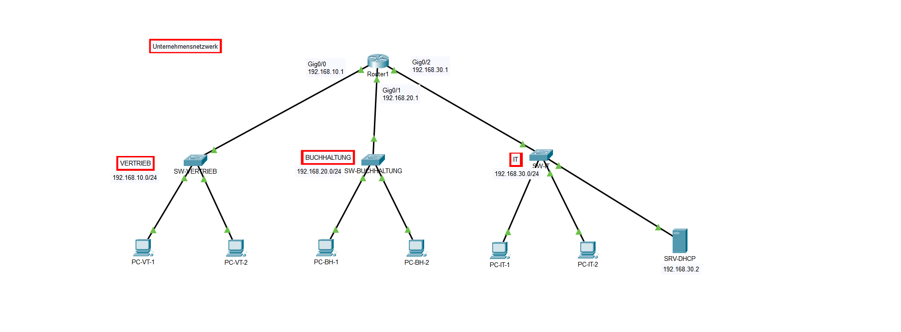
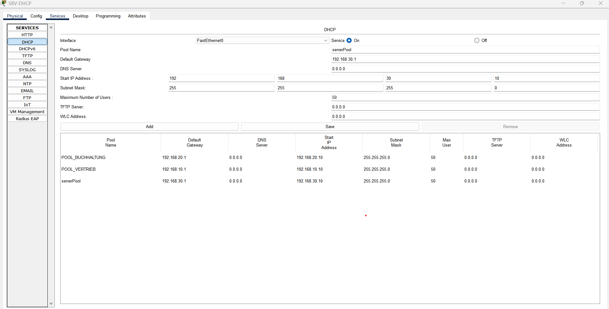
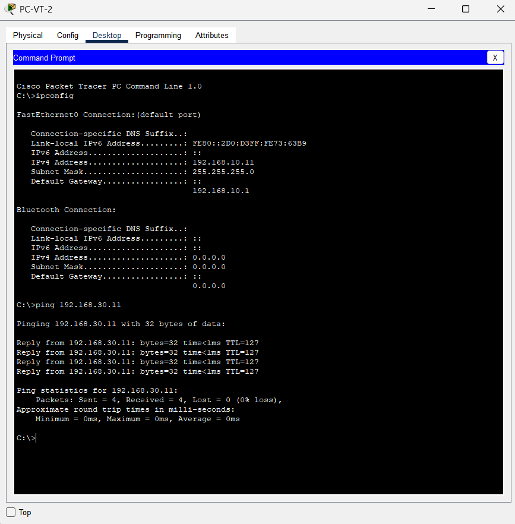

# Simulation eines Unternehmensnetzwerks mit zentralem DHCP-Server (Cisco Packet Tracer)

## Projektübersicht
In diesem Projekt habe ich ein Firmennetzwerk für ein kleines Unternehmen mit drei getrennten Abteilungen (Vertrieb, Buchhaltung und IT) in Cisco Packet Tracer geplant, aufgebaut und getestet.

Das Ziel war es, alle drei Netze über einen Router zu verbinden und die IP-Adressen automatisch über einen einzigen zentralen DHCP-Server zu vergeben. Dafür habe ich auf dem Router DHCP-Relay (ip helper-address) eingerichtet.

---

## Netzwerktopologie

### Verwendete Geräte
* 1× Router: Cisco 2911 (Router1) – verbindet die drei Netze und leitet DHCP-Anfragen weiter
* 3× Switches: Cisco 2960-24TT (SW-VERTRIEB, SW-BUCHHALTUNG, SW-IT) – verbinden die Computer in jeder Abteilung
* 1× Server: SRV-DHCP – zentraler DHCP-Server mit fester IP-Adresse im IT-Netz
* 6× Clients: PC-VT-1, PC-VT-2, PC-BH-1, PC-BH-2, PC-IT-1, PC-IT-2 (bekommen ihre IP-Adresse automatisch über DHCP)

---

## IP-Adressenplan

| Abteilung | Netzwerkadresse | Subnetzmaske | Router-Interface (Standard-Gateway) | DHCP-Pool-Name | DHCP-Bereich | Hinweise |
| :--- | :--- | :--- | :--- | :--- | :--- | :--- |
| Vertrieb | 192.168.10.0/24 | 255.255.255.0 | Gig0/0 – 192.168.10.1 | POOL_VERTRIEB | .10 – .59 | DHCP-Relay aktiv |
| Buchhaltung | 192.168.20.0/24 | 255.255.255.0 | Gig0/1 – 192.168.20.1 | POOL_BUCHHALTUNG | .10 – .59 | DHCP-Relay aktiv |
| IT | 192.168.30.0/24 | 255.255.255.0 | Gig0/2 – 192.168.30.1 | serverPool | .10 – .59 | SRV-DHCP statisch: 192.168.30.2 |

*Hinweis: Die Adressen .1 bis .9 sind in jedem Netz für Router und Server reserviert, damit es keine IP-Konflikte gibt.*

---

## Konfiguration

### 1. Router-Konfiguration (Router1)
Router leiten Broadcast-Anfragen normalerweise nicht an andere Netze weiter. Deshalb erreichen DHCP-Anfragen aus dem Vertrieb und der Buchhaltung den Server im IT-Netz nicht direkt. Mit dem Befehl ip helper-address 192.168.30.2 auf Gig0/0 und Gig0/1 leitet der Router diese Anfragen direkt an den zentralen DHCP-Server weiter.

enable
configure terminal

interface GigabitEthernet0/0
 ip address 192.168.10.1 255.255.255.0
 ip helper-address 192.168.30.2
 no shutdown

interface GigabitEthernet0/1
 ip address 192.168.20.1 255.255.255.0
 ip helper-address 192.168.30.2
 no shutdown

interface GigabitEthernet0/2
 ip address 192.168.30.1 255.255.255.0
 no shutdown

end
write memory
### 2. DHCP-Server (SRV-DHCP)
* Statische IP-Adresse: 192.168.30.2 / 255.255.255.0, Standard-Gateway 192.168.30.1
* DHCP-Pools: Für jede Abteilung wurde ein eigener Pool mit dem passenden Standard-Gateway und Start-IP ab .10 eingerichtet (Max Users: 50).

---

## Tests und Ergebnisse
Um das Netzwerk zu prüfen, habe ich zwei Tests durchgeführt:
1. Automatische IP-Vergabe (DHCP): Alle sechs Computer haben automatisch eine gültige IP-Adresse aus ihrem Netz und das richtige Standard-Gateway bekommen (keine APIPA-Adresse 169.254.x.x).
2. Ping-Test zwischen den Abteilungen: Die Verbindung zwischen den verschiedenen Netzen funktioniert ohne Probleme (z. B. Ping von PC-VT-1 im Vertrieb zu PC-BH-1 in der Buchhaltung und zu PC-IT-1 in der IT).

